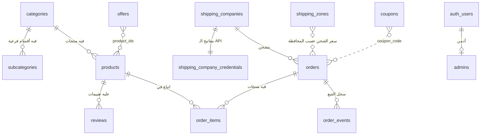

# خريطة قاعدة البيانات — بابا المجال (Supabase)

الملف ده بيشرحلك قاعدة البيانات **حتة حتة**: كل ملف فيه إيه، بيتشغل إمتى، وكل جدول مربوط بأنهي صفحة في الموقع.

---

## 1) شكل الفولدر

```
database/
├── schema/                       ← الجداول والدوال والحماية (مقسمة)
│   ├── 00_helpers_and_admins.sql   الأساسيات + جدول الأدمن
│   ├── 01_settings.sql             إعدادات الموقع
│   ├── 02_catalog.sql              الأقسام + المنتجات + التقييمات
│   ├── 03_offers.sql               العروض + الكوبونات + عجلة الحظ
│   ├── 04_shipping.sql             شركات الشحن + أسعار المحافظات
│   ├── 05_orders.sql               الطلبات + سجل التتبع
│   ├── 06_content.sql              محتوى الصفحات + المشتركين
│   ├── 07_integration_logs.sql     سجلات المخزن والشحن
│   ├── 08_triggers.sql             تحديثات تلقائية
│   ├── 09_pricing_functions.sql    حساب الأسعار بعد العروض
│   ├── 10_place_order.sql          تسجيل الطلب
│   ├── 11_tracking.sql             تتبع الشحنة + التحقق من الكوبون
│   ├── 12_security_rls.sql         الحماية (مين يشوف إيه)
│   └── 13_storage_and_first_admin.sql   الصور + تفعيل أول أدمن
│
├── seed/                         ← البيانات الافتراضية (مقسمة)
│   ├── 01_settings.sql   02_catalog.sql   03_offers.sql
│   ├── 04_shipping.sql   05_content.sql
│
├── schema.sql     ← كل ملفات schema/ في ملف واحد (لو عايز تلصق مرة واحدة)
└── seed.sql       ← كل ملفات seed/ في ملف واحد
```

> **ماتعدلش في `schema.sql` أو `seed.sql` مباشرة** — دول بيتولدوا تلقائي.
> عدّل الملف الصغير في `schema/`، أو البيانات في `src/data/`، وبعدين شغّل:
> ```bash
> npm run db:build
> ```

---

## 2) ترتيب التشغيل في Supabase

Supabase ← **SQL Editor** ← New query ← الصق الملف ← **Run**

| الخطوة | الطريقة السريعة | أو ملف ملف (علشان تفهم كل خطوة) |
|---|---|---|
| ① الجداول | `schema.sql` | `schema/00` ← `01` ← … ← `13` بالترتيب |
| ② البيانات | `seed.sql` | `seed/01` ← … ← `05` بالترتيب |
| ③ أول أدمن | السطر اللي آخر `13_storage_and_first_admin.sql` (بعد ما تعمل يوزر من Authentication) | |

كل الملفات **آمنة تتشغل أكتر من مرة** (مش هتعمل جداول مكررة ولا بيانات مكررة).

### قائمة "أنا عملت إيه؟" ✅
- [ ] عملت مشروع Supabase (منطقة Frankfurt)
- [ ] شغّلت `schema.sql` (أو 00 → 13)
- [ ] شغّلت `seed.sql` (أو 01 → 05)
- [ ] عملت يوزر من Authentication ← Users
- [ ] شغّلت سطر تفعيل الأدمن بإيميلي
- [ ] حطيت `VITE_SUPABASE_URL` و `VITE_SUPABASE_ANON_KEY` في `.env` وفي الاستضافة
- [ ] من لوحة التحكم ← الإعدادات ← الربط: سجلت دخول Supabase ودوست "رفع كل البيانات"
- [ ] عملت طلب تجربة وتتبعته من موبايل تاني

**إزاي تتأكد إن كل حاجة اتعملت؟** شغّل ده في SQL Editor:
```sql
select 'منتجات' as الجدول, count(*) from products
union all select 'أقسام', count(*) from categories
union all select 'عروض', count(*) from offers
union all select 'شركات شحن', count(*) from shipping_companies
union all select 'إعدادات', count(*) from site_settings
union all select 'أدمن', count(*) from admins;
```
المتوقع بعد البيانات الافتراضية: 33 منتج، 6 أقسام، 4 عروض، 4 شركات شحن، 27 إعداد، وأدمن واحد على الأقل.

---

## 3) كل ملف بالتفصيل

| الملف | الجداول / الدوال | بيخدم أنهي جزء في الموقع |
|---|---|---|
| `00_helpers_and_admins` | `admins`, `is_admin()`, `set_updated_at()` | دخول لوحة التحكم |
| `01_settings` | `site_settings`, `integration_settings` | الإعدادات: ألوان، خطوط، SEO، تواصل، عربون، ربط المخزن |
| `02_catalog` | `categories`, `subcategories`, `products`, `reviews` | المتجر، صفحات الأقسام، صفحة المنتج، التقييمات |
| `03_offers` | `offers`, `coupons`, `wheel_prizes` | عروض اليوم، عروض الجمعة، الكوبونات، عجلة الحظ |
| `04_shipping` | `shipping_companies`, `shipping_company_credentials`, `shipping_zones` | صفحة الشحن، سعر الشحن حسب المحافظة |
| `05_orders` | `orders`, `order_items`, `order_events` | إتمام الطلب، صفحة الطلبات، العربون، التتبع |
| `06_content` | `hero_slides`, `partners`, `store_features`, `content_blocks`, `subscribers` | الرئيسية، من نحن، الفوتر، النشرة |
| `07_integration_logs` | `inventory_sync_log`, `shipping_webhook_log` | دوال السيرفر (المخزن وشركات الشحن) |
| `08_triggers` | تحديث `updated_at` تلقائي | — |
| `09_pricing_functions` | `offer_is_live()`, `effective_price()`, `setting()` | السعر بعد العروض (بتوقيت القاهرة) |
| `10_place_order` | `place_order(payload)` | زرار "تأكيد الطلب" |
| `11_tracking` | `track_order(number, phone)`, `validate_coupon(code)` | صفحة `/track` + الكوبون |
| `12_security_rls` | سياسات الحماية + الصلاحيات | كل الموقع |
| `13_storage_and_first_admin` | مكان الصور `images` + تفعيل الأدمن | رفع صور المنتجات |

---

## 4) الجداول مربوطة ببعض إزاي؟



(الرسم ده بيظهر على GitHub أو في VS Code بإضافة Markdown Preview Mermaid.)

**بالكلام:**
- كل **منتج** تبع **قسم** (`category_id`)، وممكن يكون عليه **تقييمات** كتير.
- **العرض** فيه قائمة أرقام منتجات (`product_ids`)، وفي يومه سعر المنتجات دي بينزل.
- كل **طلب** فيه **منتجات** (`order_items`) و**سجل تتبع** (`order_events`)، ومربوط بـ **شركة شحن**.
- **الأدمن** = يوزر من Supabase Auth متسجل في جدول `admins`.

---

## 5) إيه اللي بيحصل لما عميل يطلب؟

```
العميل يدوس "تأكيد الطلب"
        │
        ▼
place_order(payload)          ← 10_place_order.sql
   ├─ يتأكد إن البيانات سليمة (الاسم + موبايل 01xxxxxxxxx)
   ├─ لكل منتج: يجيب السعر من products + effective_price() (العروض)  ← 09
   ├─ يتأكد إن الكمية متوفرة في المخزون
   ├─ الكوبون من coupons                                               ← 03
   ├─ الشحن من shipping_zones (أو الشحن الافتراضي من site_settings)     ← 04 / 01
   ├─ العربون من site_settings ← deposit                               ← 01
   ├─ يسجل في orders + order_items + أول حدث في order_events           ← 05
   └─ يخصم الكمية من products.stock
        │
        ▼
الأدمن يغير الحالة / يكتب ملاحظة / يأكد العربون  → صف جديد في order_events
        │
        ▼
العميل يفتح /track ← track_order(رقم الطلب، الموبايل)                  ← 11
   └─ يشوف الحالة + شركة الشحن + البوليصة + السجل كله
```

**ليه الأسعار بتتحسب في قاعدة البيانات مش في المتصفح؟** علشان محدش يقدر يغير سعر المنتج من المتصفح ويطلب بسعر غلط.

---

## 6) مين يقدر يعمل إيه؟ (`12_security_rls.sql`)

| | الزائر | الأدمن |
|---|---|---|
| المنتجات المفعّلة، الأقسام، العروض، المحتوى، الإعدادات العامة | 👀 يقرا | ✏️ كل حاجة |
| التقييمات | يقرا الظاهر + يكتب تقييم | ✏️ |
| المشتركين | يشترك بس | ✏️ |
| الطلبات | ❌ مايشوفش الجدول — يطلب ويتتبع **عن طريق الدوال بس** | ✏️ |
| الكوبونات | ❌ مايشوفش الأكواد — بيتحقق بـ `validate_coupon` | ✏️ |
| مفاتيح API الشحن والمخزن | ❌ | ✏️ (وكمان دوال السيرفر) |

> ⚠️ الـ `anon key` آمن يتحط في الموقع لأن الحماية دي شغالة. الـ `service_role key` **ممنوع** يتحط في الموقع.

---

## 7) عايز تضيف حاجة جديدة؟

| عايز | تعدّل فين |
|---|---|
| عمود جديد في المنتجات | `schema/02_catalog.sql` + `src/data/products.js` + `src/lib/supabase.js` (رفع وتحميل) ← `npm run db:build` |
| إعداد جديد | `src/data/settings.js` بس — بيتخزن تلقائي في `site_settings` |
| حالة طلب جديدة | `schema/05_orders.sql` (الـ check) + `src/lib/format.js` (ORDER_STATUSES) |
| شركة شحن جديدة بالـ API | لوحة التحكم ← الشحن، والربط في `supabase/functions/create-shipment` |
